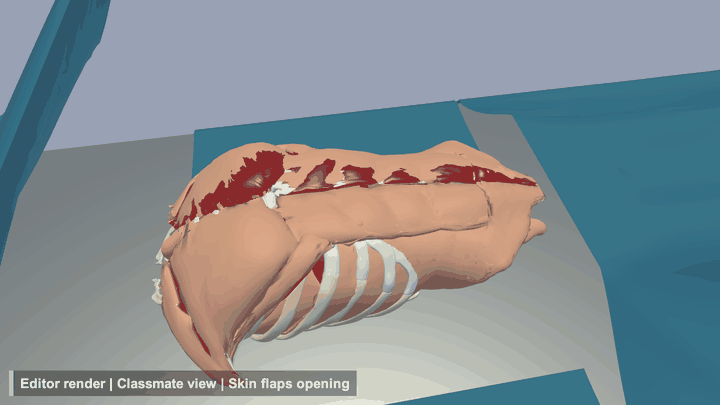
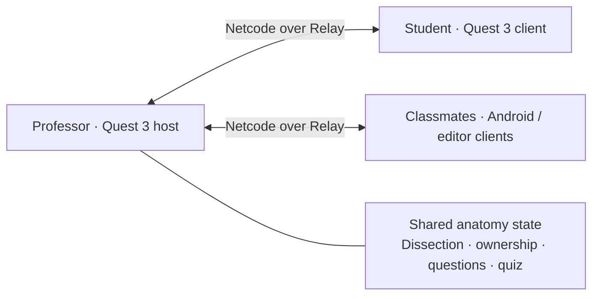

<div align="center">

# DIYsect

### One shared body. Every student has a view.

A multiplayer anatomy classroom across mixed reality, virtual reality, and phones.


**Built for the Immersion Studio Hackathon · November 6–9, 2026**

[The experience](#the-experience) · [Screenshots](#screenshots) · [Run it](#run-it) · [Demo walkthrough](docs/DEMO_SCRIPT.md) · [Architecture](docs/ARCHITECTURE.md)


<sub>Professor-side development capture rendered in Unity. The screenshots below are editor renders; they are not headset or phone recordings.</sub>

</div>

## Why we built it

An anatomy demonstration has one specimen and a room full of people trying to see it. Students look from different angles, questions lose their context, and a professor wearing a headset cannot easily see who needs help.

**DIYsect turns the dissection into a shared classroom.** A professor guides the session, a student performs the dissection in VR, and classmates participate from Android phones or a laptop running the Unity editor. Everyone sees the same anatomy and dissection state while keeping control of their own view.

The central idea is **shared state, private views, and questions attached to the anatomy itself**.

## The experience

| Role | Device | What they do |
|---|---|---|
| **Professor** | Meta Quest 3 | Host the class, use passthrough or the virtual classroom, place the anatomy table, draw guidance, control scalpel depth, inspect questions and run quizzes. |
| **Student** | Meta Quest 3 | Pick up instruments, trace the incision, open the body layers, lift and inspect organs, return them to their sockets and answer quizzes with the controller. |
| **Classmate** | Android phone or laptop/editor | Join the room, orbit and zoom, follow another view, tap organs for names, pin questions, draw on the body and raise a hand to speak. |

### What makes it a classroom

- **Anatomy that stays in sync.** The server validates dissection order and organ ownership, so everyone follows the same procedure.
- **Guidance at the point of action.** A guide line and shared scalpel-depth control help the professor explain a cut while the student performs it.
- **Questions with a location and a viewpoint.** Pins stay attached to organs. Duplicate questions cluster, and the professor can inspect the asker's view and mark a question answered.
- **Pointers translated into your view.** A professor's pointer identifies the same organ from each classmate's camera, with an edge arrow when it is off screen.
- **Participation from a phone.** Tap to identify an organ, hold to ask, drag to explore, or switch on Draw to sketch directly on the shared body. The roster and speaking controls help the professor manage participation.
- **A learning loop.** Step guidance, organ information and quizzes connect the hands-on procedure to the rest of the class. Headset students answer with a trigger; phone classmates answer with a tap.

## Screenshots

These development images show selected interaction states. Some labels and panels have evolved since capture. [Capture notes and provenance](docs/media/README.md) describe how the editor renders were produced.

<table>
  <tr>
    <td width="50%">
      
      <p><strong>Follow the procedure.</strong> Trace the incision before opening the body layers.</p>
    </td>
    <td width="50%">
      
      <p><strong>Explore layer by layer.</strong> Reveal the anatomy and work toward organ inspection.</p>
    </td>
  </tr>
  <tr>
    <td>
      
      <p><strong>Ask about this part.</strong> Questions remain anchored to the organ they refer to.</p>
    </td>
    <td>
      
      <p><strong>See what they meant.</strong> Open the view associated with a question and mark it answered.</p>
    </td>
  </tr>
  <tr>
    <td>
      
      <p><strong>Keep the explanation in view.</strong> Off-screen pointers help classmates find the same organ.</p>
    </td>
    <td>
      
      <p><strong>Guide the cut together.</strong> The depth indicator shows when the professor controls scalpel depth.</p>
    </td>
  </tr>
</table>

<div align="center">
  
  <p><em>Dissection progression in motion · Unity editor render</em></p>
</div>

## The demo in 90 seconds

1. **Join the class.** Start the professor app, then the student app and classmates. Join from the phone start screen or enter the room code.
2. **Guide and dissect.** Draw a guide line, demonstrate scalpel-depth guidance, trace the incision and open the layers.
3. **Inspect an organ.** Lift an organ, examine it and return it to its socket while the class follows from their own views.
4. **Ask and answer.** A classmate holds an organ to place a question pin. The professor opens the saved viewpoint and marks the question answered.
5. **Check understanding.** Start a quiz. The student points and pulls a trigger; phone classmates tap their answers.

See the [rehearsal script](docs/DEMO_SCRIPT.md) and [video plan](docs/VIDEO_PLAN.md) for the full presentation and recording sequence.

## How it works



**The host owns the lesson state.** Clients request actions; the server decides whether a cut, grab, dissection step or quiz answer is valid. Each device renders the synchronized anatomy locally. Cameras, follow modes and the close-up Render Texture provide different views of that same state.

| Layer | Technology |
|---|---|
| Application | Unity **6000.3.28f1**, C#, Universal Render Pipeline |
| Headset interaction | OpenXR, XR Interaction Toolkit, Unity Input System |
| Mixed reality | AR Foundation and Unity's Meta OpenXR integration |
| Multiplayer | Netcode for GameObjects, Unity Transport, Authentication, Lobby and Relay |
| Voice | Vivox with classmate speaking controls |
| Anatomy pipeline | Z-Anatomy, Blender/Python processing and glTFast import |

## Run it

### 1. Open the Unity project

Install **Unity 6000.3.28f1** through Unity Hub, including **Android Build Support**, SDK/NDK tools and OpenJDK. For the complete device demo, use two Quest 3 headsets and an Android phone with internet access.

```bash
git clone https://github.com/Imersive-studio/DIYsect-XR.git
cd DIYsect-XR
git lfs install --local
git lfs pull
```

Add this existing folder to Unity Hub and open it. The repository includes `Assets/`, `Packages/` and `ProjectSettings/`; allow package resolution and model imports to finish.

Link the Unity project to the team's Unity Gaming Services project, or configure your own services for Authentication, Lobby, Relay and Vivox. Team accounts need access to the linked cloud project. See [deployment and service setup](docs/DEPLOYMENT.md) for details; keep credentials and service keys out of commits.

### 2. Use the shared scene

Open **`Assets/Scenes/Professor_MR.unity`**. All three role builds use this scene. `ClassroomRole` selects the appropriate headset or phone experience from the app's package suffix; the editor defaults to the classmate view.

For an editor-hosted networking check, enter Play mode, wait for authentication, then use **Tools → DIYsect → Host Test Lobby (Play Mode)**. For the full classroom demo, launch the **Professor app first** so it hosts the session.

`LectureHall_VR` and `Classmate_Desktop` remain development scenes. Build the role apps from the shared scene for a shared classroom session.

### 3. Build and install

Choose **Tools → DIYsect → Build All Demo APKs**. It builds all roles from one commit and records their paths, sizes and commit in `Builds/DemoBuilds.txt`.

| App | Output |
|---|---|
| Professor | `Builds/Android-Professor/DIYsect-Professor.apk` |
| Student | `Builds/Android-Student/DIYsect-Student.apk` |
| Classmate | `Builds/Android-Classmate/DIYsect-Classmate.apk` |

```bash
# Replace Unity with the path to your installed editor. Keep graphics enabled.
Unity -batchmode -projectPath . -buildTarget Android -executeMethod DIYsect.Editor.BuildAllDemoApks.BuildBatch

# Install the appropriate app on each connected device.
adb install -r Builds/Android-Professor/DIYsect-Professor.apk
```

The role APKs have separate package suffixes (`.professor`, `.student`, `.classmate`). Use the corresponding APK for each device. [Deployment instructions](docs/DEPLOYMENT.md) cover individual builds, installation and joining.

### 4. Run the checks

In Unity, open **Window → General → Test Runner** and run **EditMode**, then **PlayMode**. The suites cover dissection rules, organ ownership, quiz answers, gestures, scene wiring and multiplayer interactions. Headset comfort, passthrough alignment, readability and performance still need checks on the actual devices.

## Inside the repository

```text
Assets/
  Editor/              Repeatable scene, prefab and build setup
  Scripts/
    Classroom/         Questions, pointers, camera views and drawing
    Dissection/        Incision and ordered body-layer progression
    Interaction/       Instruments, grabbing, labels and feedback
    Learning/          Organ information, checklist and quizzes
    MixedReality/     Table placement and alignment
    Networking/        Shared body state and server authority
  Tests/               EditMode and PlayMode coverage
Tools/blender/         Anatomy and environment processing
docs/                  Architecture, deployment, credits and demo guides
```

The earlier browser-based frog prototype remains in `server/`, `shared/`, `vr/`, `audience/` and `public/`. It has a separate WebSocket/WebXR stack: use `npm ci`, `npm start` and `npm test` to run it. The human-anatomy classroom described above is the Unity application.

## Team

| Teammate | Focus |
|---|---|
| **Aaditya** | Networking, shared body state, organ ownership and guiding-hand depth control |
| **Saurav** | Student VR, lecture hall, incision, body layers and organ interaction |
| **Arjun** | Professor experience, desktop/Android classmates, question pins, close-up view and demo |

## Credits and project status

DIYsect is a hackathon educational prototype with simplified anatomy and synthetic skin flaps.

| Asset | Source | License |
|---|---|---|
| Human anatomy | [Z-Anatomy](https://github.com/Z-Anatomy/The-blend) | CC BY-SA 4.0; underlying BodyParts3D attribution retained |
| University Lecture Hall | [Heat Of Fusion](https://sketchfab.com/3d-models/university-lecture-hall-452cc01ebd1a47de9925bd43f44d7da4) | CC BY 4.0 |
| Surgical instruments | [ferofluid](https://sketchfab.com/3d-models/surgical-instrument-2971a44d334b45ff926792e92a6bcee7) | CC BY 4.0 |
| Seated audience imagery | [Microsoft Rocketbox](https://github.com/microsoft/Microsoft-Rocketbox) | MIT |
| Optional planar slicing source | [EzySlice](https://github.com/DavidArayan/ezy-slice) | MIT |

Asset licenses apply to their respective content. Derived anatomy and anatomy previews retain CC BY-SA 4.0. See [full credits and modifications](docs/CREDITS.md) and the [asset rebuilding guide](docs/ASSET_PIPELINE.md).

**More detail:** [Architecture](docs/ARCHITECTURE.md) · [Student controls](docs/VR_CONTROLS.md) · [Learning content](docs/LEARNING.md) · [Table alignment](docs/MR_TABLE_ALIGNMENT.md) · [Related work](docs/RELATED_WORK.md) · [Contribution workflow](docs/WORKFLOW.md)
